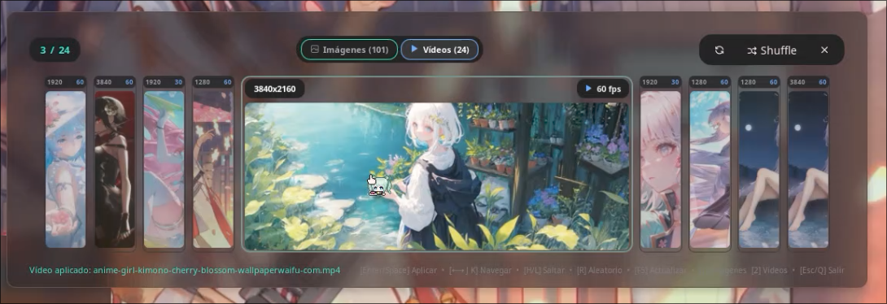

# 🎴 Wallcards for Noctalia v5

A high-performance, aesthetically crafted wallpaper manager and carousel for **[Noctalia](https://github.com/noctalia-dev/noctalia)** supporting both **Static Images** and **Live Video Wallpapers** (via `gslapper`) with dynamic shell color extraction.

# Preview

---

## ✨ Features

- 🖼️ **Dual Wallpaper Engine**:
  - **Imágenes (Static)**: Instantly sets static wallpapers (`.png`, `.jpg`, `.jpeg`, `.webp`, `.bmp`, `.avif`, `.gif`) and extracts dominant colors so the Noctalia shell automatically adapts its color palette.
  - **Vídeos (Animated)**: Plays live video wallpapers (`.mp4`, `.mkv`, `.webm`, `.avi`, `.mov`) seamlessly on Wayland shell surfaces via `gslapper`.
- ⚡ **Zero UI Freezing (Async Pipeline)**:
  - Video and high-res image thumbnails are extracted in the background via `ffmpeg` & `imagemagick` with a concurrent worker queue.
  - Thumbnails and metadata (resolution, frame rate, dominant color) are cached in `~/.cache/noctalia/wallcards/` for instant subsequent loads.
  - Instant synchronous directory scanning on panel open.
- 🔁 **Auto-Resume Video Wallpapers**:
  - Automatically resumes your last active video wallpaper upon starting a new Noctalia session.
- 🗂️ **Tab Filtering**:
  - Quick tab switching between **Imágenes** (Images) and **Vídeos** (Videos) with live badge counts and keyboard hotkeys.
- 🎯 **Seamless Apply**:
  - Press `Enter` or `Space` to apply any static or video wallpaper directly without interrupting your workflow.
- 🔄 **Quick Refresh**:
  - Dedicated Refresh button and `F5` shortcut to immediately detect newly added or deleted wallpapers.
- 🎨 **Signature Deck Carousel Interface**:
  - Smooth centered hero card displaying resolution badge and format tags, flanked by sleek thumbnail preview strips.

---

## 📦 Dependencies

Ensure the following tools are installed on your Linux system:

| Package | Command | Purpose |
| --- | --- | --- |
| **ImageMagick** | `magick` or `convert` | Fast image thumbnailing and dominant color palette extraction |
| **FFmpeg** | `ffmpeg` | Frame extraction and metadata probing for video wallpapers |
| **gSlapper** | `gslapper` | High-performance Wayland video wallpaper daemon ([gSlapper GitHub](https://github.com/Nomadcxx/gSlapper)) |

### Installing Dependencies

- **Arch Linux / Manjaro**:
  ```bash
  sudo pacman -S imagemagick ffmpeg
  # Install gslapper from AUR:
  yay -S gslapper-bin # or build from https://github.com/Nomadcxx/gSlapper
  ```
- **Fedora**:
  ```bash
  sudo dnf install ImageMagick ffmpeg
  ```
- **Ubuntu / Debian**:
  ```bash
  sudo apt install imagemagick ffmpeg
  ```

---

## 🚀 Installation

Clone this repository into your Noctalia plugins folder:

```bash
mkdir -p ~/.local/share/noctalia/plugins
git clone https://github.com/Imhatsune/wallcards.git ~/.local/share/noctalia/plugins/wallcards
```

Then reload or enable the plugin in Noctalia:

```bash
noctalia msg plugins enable imhatsune/wallcards
```

Or enable it via **Noctalia Settings > Plugins > Wallcards**.

---

## ⌨️ Controls & Keybindings

When the Wallcards panel is open:

| Key | Action |
| --- | --- |
| `Enter` / `Space` | **Apply wallpaper** (keeps panel open) |
| `←` / `→` or `J` / `K` | Navigate between cards (previous / next) |
| `H` / `L` | Fast jump (4 cards back / 4 cards forward) |
| `1` | Switch to **Imágenes** tab |
| `2` | Switch to **Vídeos** tab |
| `R` | **Shuffle** (random wallpaper) |
| `F5` | **Refresh** wallpaper list |
| `Esc` / `Q` | Close panel |

---

## ⚙️ Configuration

You can customize Wallcards in **Noctalia Settings > Plugins > Wallcards**:

| Setting | Type | Default | Description |
| --- | --- | --- | --- |
| `wallpaper_dir` | Folder | `~/Imágenes/Wallpapers` | Directory where your images and video wallpapers are stored |
| `card_height` | Integer | `230` (180–340px) | Height of the carousel cards |
| `icon_color` | Color | `none` | Custom accent color for the top bar widget icon |

---

## 📂 File Structure

```text
wallcards/
├── assets/
│   └── preview.png          # UI preview screenshot
├── translations/            # Localization files (16 languages)
│   ├── en.json
│   ├── es.json
│   └── ...
├── panel.luau               # Main carousel interface & wallpaper applier
├── widget.luau              # Top bar widget & startup video auto-resume
├── shortcut.luau            # Control Center quick toggle tile
├── plugin.toml              # Noctalia plugin manifest
├── README.md                # Documentation
└── LICENSE                  # MIT License
```

---

## 📄 License

This project is licensed under the [MIT License](LICENSE).
